# Presente · nuovo design dell'app (v4, approvato da Giuseppe il 22/11/2026)

**Regola:** l'app deve essere graficamente **identica** a queste schermate. Ogni differenza (colori, caratteri, spaziature, pulsanti, animazioni, testi) va chiesta a Giuseppe prima, nella plancia. In caso di dubbio vale il prototipo.

## Dove sta il riferimento

- `prototipo/index.html`: il prototipo vivo con tutte le 41 schermate e le animazioni. Si apre in locale con `python3 -m http.server` dentro `prototipo/`, poi `http://localhost:8000/#<id>` (es. `#n14`). Il codice CSS delle schermate è nella sezione `/* ===== il telefono: nuovo design ===== */`: **usate quei valori**, non stime.
- `schermate/*.png`: le 41 schermate a 2x (780 × 1688), una per file, nell'ordine del percorso.
- `immagini/`: le immagini dei fondi (generate con AI, nessuna persona reale, volti mai a fuoco).
- Anteprima online per Giuseppe: pagina «Dentro Presente» su claude.ai (privata).

## Regole grafiche valide in tutta l'app

| Elemento | Regola |
| --- | --- |
| Testata | Logo «presente!» **al centro**, Instrument Serif corsivo 30px, «!» rosso `#E8432B`. Sotto, l'**onda della voce**: 21 barre da 3px, arrotondate, alte da 5 a 20px secondo una curva morbida, colori dalla scala dei rossi (più chiari al centro) con un leggero alone. L'onda respira piano (3,2 s); in chiamata e durante la registrazione si muove più veloce (1,6 s). |
| Saldo Coin | Pillola in alto a sinistra (moneta rossa + numero). Diventa rossa quando il saldo è **sotto 80 Coin** (costo di una stanza). Non c'è nelle schermate di iscrizione prima dei Coin. |
| Profilo | Cerchio con l'iniziale in alto a destra; apre il profilo. «Elimina il mio account» **solo** nel profilo. |
| Colori | Fondo `#0E0D10`; superfici `#151217` / `#1A171D`; testo `#F2EDE4`; note `#A8A29A`; scala dei rossi `#8F2414 #B83220 #C7361F #D63A22 #E8432B #F05A43 #F46A53 #FF7A62`. |
| Caratteri | Titoli, numeri e **testo dei pulsanti**: Instrument Serif. Testo, etichette (maiuscolo spaziato 10,5px, .2em): Instrument Sans. Nient'altro. |
| Pulsanti | **3D** (classe `.b3`): alti 52px, raggio 16px, testo Instrument Serif **maiuscolo** 19px, spaziatura .07em. Primario: sfumatura `#F46A53 → #E8432B → #D63A22`, bordo inferiore pieno `0 6px 0 #8F2414`, ombra morbida, luce in alto. Secondario: sfumatura `#2C282F → #1C191F`, bordo inferiore `#050406`. Premuto: scende di 4px. «ENTRA» nella prima schermata: 64px, testo 26px. |
| Piede | I pulsanti stanno **sempre in basso nello stesso punto**, sulla stessa riga e alti uguali: griglia `1fr 1.7fr` (secondario a sinistra, primario a destra), oppure un solo pulsante a tutta larghezza; margini 22px, 30px dal fondo. |
| Movimento | Lento e morbido (`cubic-bezier(.45,0,.55,1)`). Niente lampeggi. Rispettare «riduci movimento» del telefono. |
| Ombre | Ammesse sui pulsanti 3D e sugli aloni rossi (decisione di Giuseppe, vale più del brand book). |

## Funzioni nuove da sviluppare (oltre alla grafica)

1. **Coin dopo l'iscrizione** (passo 10 di 10): pacchetti 200 Coin = 20 € e 500 + 50 Coin = 45 €; costi mostrati: stanza 80, caparra 10, regali 5/10/20. Pagamento con **Gomry** (Apple Pay, Google Pay, carta) in un foglio dal basso; conferma con il saldo che sale. Le condizioni con Gomry (commissioni, contratto dati) sono ancora da chiudere: chiedere a Giuseppe prima di collegare i pagamenti veri.
2. **Saldo sempre visibile** e avviso «Ti restano N Coin» quando non bastano per la prossima stanza, con «Dopo» / «Ricarica».
3. **Stanza viva**: stato di ogni persona (online, in chiamata, non in linea); nel cerchio una linea rossa tratteggiata che scorre unisce chi è in chiamata; nell'elenco «in chiamata con …».
4. **Cerchio e elenco divisi tra uomini e donne** (uomini a sinistra, donne a destra; sotto prima gli uomini, poi le donne). «Chiama» e «Dai una chiave» sulla stessa riga; «Fissa» al posto di «Chiama» se la persona è occupata o non in linea.
5. **Fino a 3 chiamate con ogni persona** della stanza in una settimana, con il contatore «chiamate N di 3».
6. **Fissa una chiamata**: giorno + ora + messaggio; l'altra persona conferma o propone un altro orario; promemoria a tutti e due 10 minuti prima; l'appuntamento compare in cima alla stanza.
7. **Lascia la stanza** con motivo obbligatorio (elenco o testo libero); gli altri vedono solo che la persona è uscita.
8. **Home che cambia con la settimana** (conto alla rovescia al lunedì; domenica sera conto alla rovescia alle 21). Mai «Il tuo profilo è pronto» nella sera delle porte.
9. **Chiamata**: mentre squilla, onda che pulsa; durante la chiamata, onda viva sopra una sagoma che ondeggia dietro un vetro rosso, **dell'altro genere rispetto a chi parla** (`immagini/chiamata-uomo.jpg` se parla una donna, `immagini/chiamata-donna.jpg` se parla un uomo).
10. **Regali in chiamata**: tasto «Regalo», foglio con rosa (5), spumante (10), fiori (20); chi riceve vede il regalo comparire sopra la chiamata. **Storico dei regali** nel profilo, per tipo e per persona.
11. **La porta**: porta scorrevole che si apre **una volta sola**, morbida, in 6 secondi; dietro, luce calda e la sagoma dell'altra persona (se sei donna `immagini/porta-uomo-rosa.jpg`, se sei uomo `immagini/porta-donna-rosa.jpg`). Domenica sera: `immagini/porta-calda.jpg`.
12. **Svelamento · come**: due schede (videochiamata 10 s / foto) e il selettore «Adesso / Scegli un orario».
13. **Scegli la stanza** (quando ci saranno più stanze): prima la più affine, poi Esperienza e VIP con «in arrivo». Non serve per la beta.
14. **Il Filo della stanza** · nuova, decisa da Giuseppe il 22/11 (nome scelto: «il Filo», resta «Filo» in tutte le lingue, «Red Thread» come spiegazione). Ogni stanza ha una persona vera della città che la accompagna:
    - **Lunedì, apertura**: un vocale di benvenuto (fino a 90 s) caricato dal Filo prima dell'apertura. Presenta le 12 persone **solo con il nome di battesimo** e ricorda le regole. Schermata «Il Filo apre la stanza» (`#madrina-apre`): scheda con il simbolo «!» nel cerchio rosso, onda grande, elenco dei nomi (tu in rosso), regole in una riga, «Entra nella stanza». Il vocale resta riascoltabile dalla stanza per tutta la settimana.
    - **Domenica, prima delle 21**: un secondo vocale del Filo con **quante** porte si sono aperte, mai chi (schermata `#madrina-domenica`). Il numero lo calcola il server dalle chiavi reciproche e lo vede il Filo in un pannello suo, senza nomi.
    - **Serata della stanza (in arrivo, non per la beta)**: invito con giorno, ora e locale consigliato; il Filo presenta tutti, anche chi non ha scelto nessuno; «Non vengo» / «Ci sarò» (`#serata-stanza`).
    - **Video per i social**: il Filo fa video alle serate. In app serve un **consenso separato e facoltativo, spento di base**, per comparire nei video; senza consenso la persona non compare. Testo del consenso e informativa: decisione di Giuseppe (privacy) prima di svilupparlo.
    - Ruolo «filo» lato server: vede la sua stanza solo con nomi di battesimo, carica i due vocali, legge il numero delle porte aperte; **mai** numeri di telefono, foto, voci, diari, chiavi date da chi a chi.

## Elenco delle schermate

| N° | Schermata | File | Id nel prototipo | Cosa fa |
| --- | --- | --- | --- | --- |
| 01 | Benvenuto | `schermate/01-benvenuto.png` | `#n01` | La prima schermata: logo centrato con l'onda della voce, una frase sola e un pulsante in 3D. |
| 02 | Passo 1 · Email | `schermate/02-passo-1-email.png` | `#n02` | «Indietro» e «Mandami il link» sono sulla stessa riga, alti uguali, in 3D. |
| 03 | Passo 2 · Età | `schermate/03-passo-2-eta.png` | `#n03` | Data di nascita su una riga, pulsanti allineati in basso. |
| 04 | Passo 3 · Le regole | `schermate/04-passo-3-le-regole.png` | `#n04` | Le regole in quattro righe brevi, con la spunta e i pulsanti allineati. |
| 05 | Passo 4 · Chi sei | `schermate/05-passo-4-chi-sei.png` | `#n05` | Nome, provincia e come ti presenti, con i pulsanti allineati. |
| 06 | Passo 5 · Chi cerchi | `schermate/06-passo-5-chi-cerchi.png` | `#n06` | Le preferenze in gruppi corti, pulsanti allineati. |
| 07 | Passo 6 · La tua voce | `schermate/07-passo-6-la-tua-voce.png` | `#n07` | Mentre registri, l'onda si muove con la tua voce. Pulsanti allineati e in 3D. |
| 08 | Passo 6 · Riascolta | `schermate/08-passo-6-riascolta.png` | `#n08` | La registrazione pronta, con «Riascolta» e «Rifai» sulla stessa riga. |
| 09 | Passo 7 · Tre risposte | `schermate/09-passo-7-tre-risposte.png` | `#n09` | Le domande come pillole, le tre scelte evidenziate. |
| 10 | Passo 8 · Questionario | `schermate/10-passo-8-questionario.png` | `#n10` | Una domanda per schermata, pulsanti allineati. |
| 11 | Passo 8 · Una domanda | `schermate/11-passo-8-una-domanda.png` | `#n11` | Domanda concreta e quanto conta per te, pulsanti allineati. |
| 12 | Passo 9 · Le foto | `schermate/12-passo-9-le-foto.png` | `#n12` | Le tre foto sfocate come le vedranno gli altri prima della porta. |
| 13 | I tuoi Coin · **nuova** | `schermate/13-i-tuoi-coin.png` | `#coin-negozio` | Nuova schermata, subito dopo l'iscrizione: quanti Coin hai, i due pacchetti e quanto costa ogni cosa. La prima stanza resta in regalo. |
| 14 | Pagamento con Gomry · **nuova** | `schermate/14-pagamento-con-gomry.png` | `#coin-pagamento` | Nuova schermata: il foglio di pagamento di Gomry sale dal basso. Presente non vede i dati della carta. |
| 15 | Coin caricati · **nuova** | `schermate/15-coin-caricati.png` | `#coin-fatto` | Nuova schermata: conferma del pagamento, con il saldo che sale. Il saldo resta sempre visibile in alto a sinistra. |
| 16 | La home | `schermate/16-la-home.png` | `#n13` | Prima della stanza: il conto alla rovescia al lunedì. L'elenco delle persone sta solo nella stanza, «Elimina account» solo nel profilo. |
| 17 | Scegli la stanza · **nuova** | `schermate/17-scegli-la-stanza.png` | `#scegli-stanza` | Nuova schermata, per quando ci saranno più stanze: in cima la stanza con le persone più affini, sotto le stanze con un'esperienza. Le esperienze sono in arrivo. |
| 18 | Il Filo apre la stanza · **nuova** | `schermate/18-il-filo-apre-la-stanza.png` | `#madrina-apre` | Nuova schermata, il lunedì all'apertura: il vocale di benvenuto del Filo della stanza (la persona vera della città che la accompagna). Dice i nomi di tutti e ricorda le regole. Si può riascoltare dalla stanza per tutta la settimana. |
| 19 | La stanza | `schermate/19-la-stanza.png` | `#n14` | Il cerchio si muove: vedi chi è online, chi è in chiamata e con chi (la linea rossa tra i due). Se una persona è occupata o non c'è, al posto di «Chiama» trovi «Fissa» per darvi un appuntamento. |
| 20 | Fissa una chiamata · **nuova** | `schermate/20-fissa-una-chiamata.png` | `#fissa-chiamata` | Nuova schermata: quando una persona è occupata o non in linea, le proponi un giorno e un'ora. Lei conferma e vi avvisiamo 10 minuti prima. |
| 21 | Coin quasi finiti · **nuova** | `schermate/21-coin-quasi-finiti.png` | `#coin-quasi-finiti` | Nuova schermata: quando i Coin non bastano per la prossima stanza, il saldo in alto diventa rosso e arriva un invito a ricaricare. |
| 22 | Lascia la stanza · **nuova** | `schermate/22-lascia-la-stanza.png` | `#n15` | Nuova schermata: chi lascia la stanza sceglie un motivo. Gli altri vedono solo che è uscito. |
| 23 | Il profilo · **nuova** | `schermate/23-il-profilo.png` | `#n16` | Nuova schermata: il profilo si apre dal cerchio in alto a destra. Qui modifichi voce, risposte, foto e preferenze; in fondo c'è «Elimina il mio account». |
| 24 | La chiamata · Squilla | `schermate/24-la-chiamata-squilla.png` | `#n17` | Mentre la linea si collega, l'onda pulsa al centro. Sotto, quante chiamate hai fatto con questa persona. |
| 25 | La chiamata · 15 minuti | `schermate/25-la-chiamata-15-minuti.png` | `#n18` | Durante la chiamata: dietro, una sagoma che si muove oltre un vetro rosso; sopra, l'onda viva della voce e il timer. |
| 26 | La chiamata · I regali · **nuova** | `schermate/26-la-chiamata-i-regali.png` | `#regali` | Nuova schermata: durante la chiamata il tasto «Regalo» apre i tre regali. Si paga con i Coin, il saldo è in alto. |
| 27 | La chiamata · Regalo ricevuto · **nuova** | `schermate/27-la-chiamata-regalo-ricevuto.png` | `#regalo-ricevuto` | Nuova schermata: chi riceve il regalo lo vede comparire sopra la chiamata, con un'animazione leggera. |
| 28 | I tuoi regali · **nuova** | `schermate/28-i-tuoi-regali.png` | `#storico-regali` | Nuova schermata, dal profilo: il numero di regali ricevuti per tipo e da chi, stanza per stanza. |
| 29 | La chiamata · Le carte | `schermate/29-la-chiamata-le-carte.png` | `#n19` | La carta rompighiaccio appare sopra lo stesso sfondo della chiamata. |
| 30 | La chiamata · Ultimo minuto | `schermate/30-la-chiamata-ultimo-minuto.png` | `#n20` | L'ultimo minuto: il timer diventa rosso, l'onda continua sopra la sagoma. |
| 31 | Dopo la chiamata | `schermate/31-dopo-la-chiamata.png` | `#n21` | Sì o no in privato, sulla stessa riga e in 3D. |
| 32 | Il diario | `schermate/32-il-diario.png` | `#n22` | Il diario privato, con «Salta» e «Salva» sulla stessa riga. |
| 33 | Le chiavi | `schermate/33-le-chiavi.png` | `#n23` | La chiave si dà da una schermata sua, con la frase e i pulsanti allineati. |
| 34 | Chiave data | `schermate/34-chiave-data.png` | `#n24` | Conferma breve; si torna alla stanza. |
| 35 | Domenica sera | `schermate/35-domenica-sera.png` | `#n25` | Domenica sera: una porta scorrevole socchiusa con la luce calda di un tavolo che aspetta. Sopra, il conto alla rovescia alle 21. |
| 36 | Il Filo · le porte aperte · **nuova** | `schermate/36-il-filo-le-porte-aperte.png` | `#madrina-domenica` | Nuova schermata, domenica poco prima delle 21: il vocale del Filo annuncia quante porte si sono aperte nella stanza. Solo il numero, mai chi. |
| 37 | La porta | `schermate/37-la-porta.png` | `#n26` | Le ante scorrono una volta sola, morbide, fino in fondo. Dietro, una luce calda e la sagoma di chi ti ha scelto, con una rosa in mano. Maschile se tu sei donna, femminile se sei uomo. |
| 38 | La porta · se sei un uomo · **nuova** | `schermate/38-la-porta-se-sei-un-uomo.png` | `#n26b` | La stessa porta vista da un uomo (qui Luca): dietro le ante, la sagoma di lei con una rosa in mano, nella stessa luce calda. Mai un volto a fuoco. |
| 39 | Lo svelamento | `schermate/39-lo-svelamento.png` | `#n27` | La caparra spiegata in tre righe, pulsanti allineati. |
| 40 | Lo svelamento · Come | `schermate/40-lo-svelamento-come.png` | `#n28` | Ridisegnata: due grandi scelte con un'immagine ciascuna (il cerchio dei 10 secondi, le foto sfocate) e l'orario in un selettore unico. |
| 41 | La serata della stanza · **nuova** | `schermate/41-la-serata-della-stanza.png` | `#serata-stanza` | Nuova schermata (in arrivo): l'invito alla serata in cui le persone della stanza si incontrano dal vivo, anche senza porte aperte. Il Filo presenta tutti, uno per uno, e racconta la serata sui social solo con chi ha detto sì. |

## Dettaglio, schermata per schermata

### 01 · Benvenuto

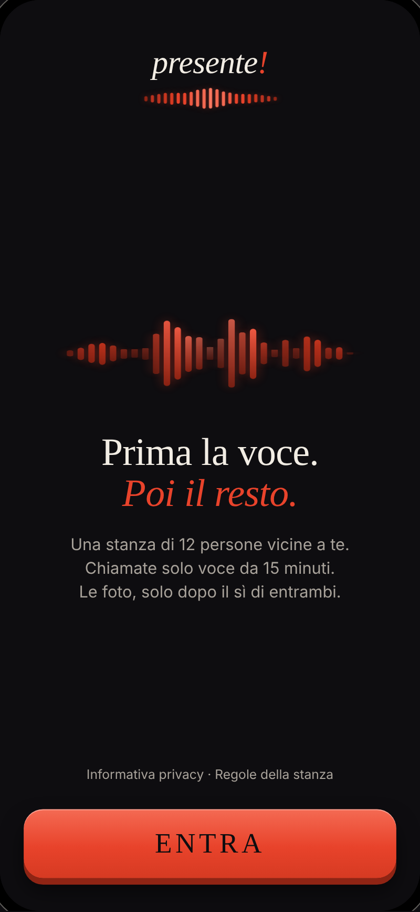

La prima schermata: logo centrato con l'onda della voce, una frase sola e un pulsante in 3D.

- Onda nei toni del rosso del brand, con linee più morbide
- «ENTRA» più grande e in maiuscolo
- Tutte le scritte dei pulsanti in maiuscolo, in tutta l'app
### 02 · Passo 1 · Email

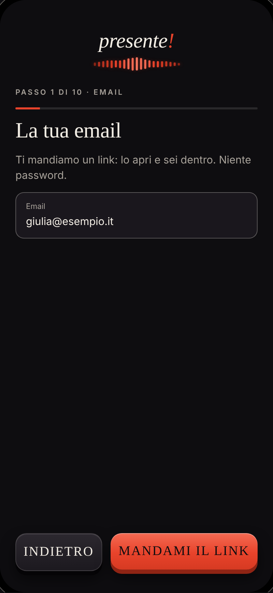

«Indietro» e «Mandami il link» sono sulla stessa riga, alti uguali, in 3D.

- Logo centrato con l'onda
- «Indietro» e «Mandami il link» allineati e alti uguali
- Pulsanti in 3D, sempre nello stesso punto
### 03 · Passo 2 · Età

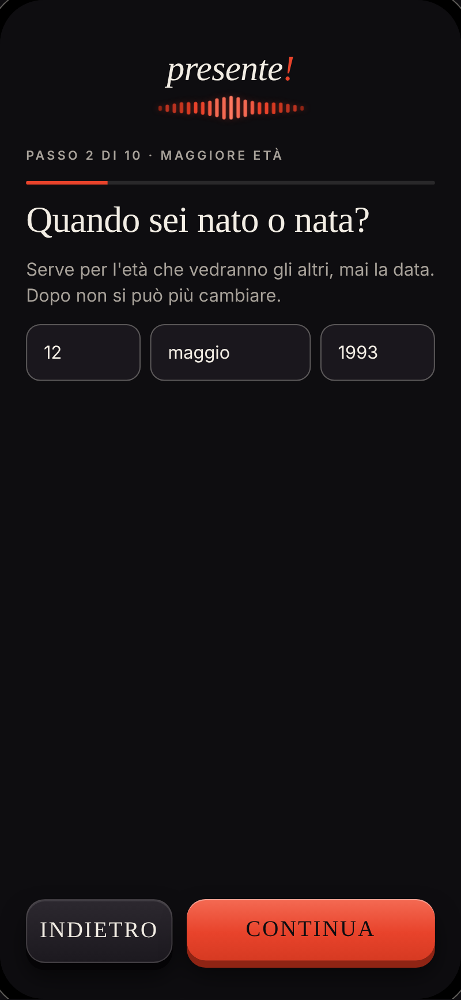

Data di nascita su una riga, pulsanti allineati in basso.

- Logo centrato con l'onda
- Pulsanti allineati e in 3D
### 04 · Passo 3 · Le regole

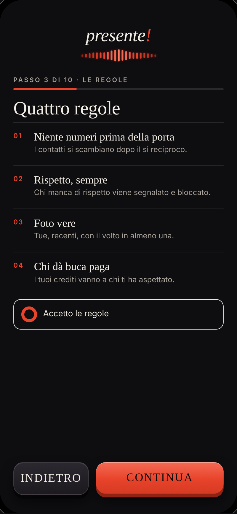

Le regole in quattro righe brevi, con la spunta e i pulsanti allineati.

- Logo centrato con l'onda
- Regole più compatte, tutte visibili senza scorrere
- Pulsanti allineati e in 3D
### 05 · Passo 4 · Chi sei

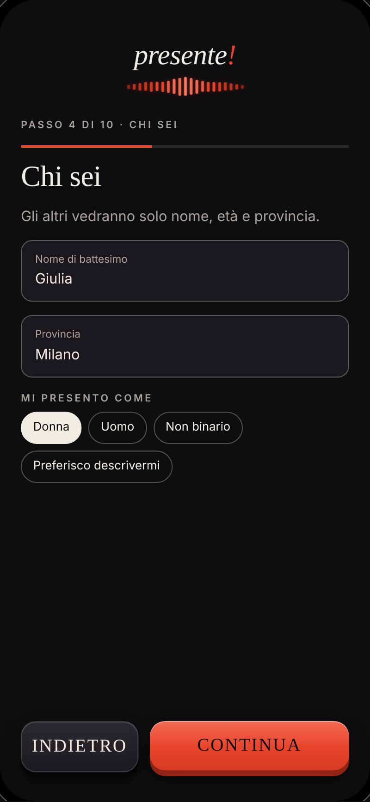

Nome, provincia e come ti presenti, con i pulsanti allineati.

- Logo centrato con l'onda
- Pulsanti allineati e in 3D
### 06 · Passo 5 · Chi cerchi

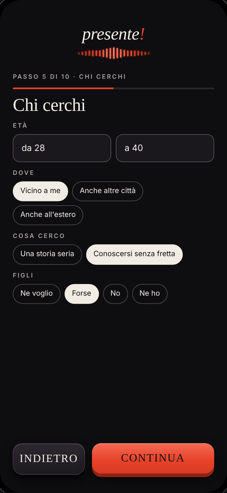

Le preferenze in gruppi corti, pulsanti allineati.

- Logo centrato con l'onda
- Pulsanti allineati e in 3D
### 07 · Passo 6 · La tua voce

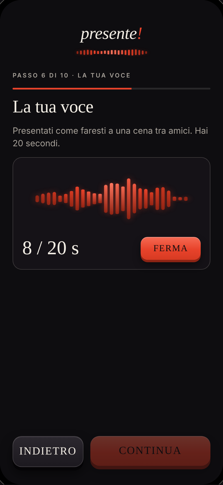

Mentre registri, l'onda si muove con la tua voce. Pulsanti allineati e in 3D.

- Logo centrato con l'onda
- Onda grande che si muove durante la registrazione
- Pulsante «Ferma» in 3D; «Indietro» e «Continua» allineati
### 08 · Passo 6 · Riascolta

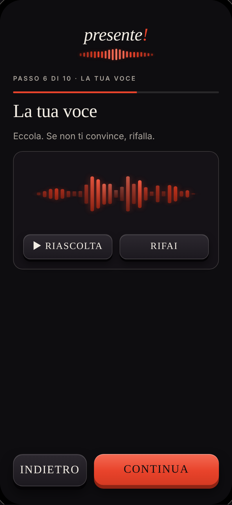

La registrazione pronta, con «Riascolta» e «Rifai» sulla stessa riga.

- Logo centrato con l'onda
- «Riascolta» e «Rifai» sulla stessa riga, in 3D
- Pulsanti in basso allineati
### 09 · Passo 7 · Tre risposte

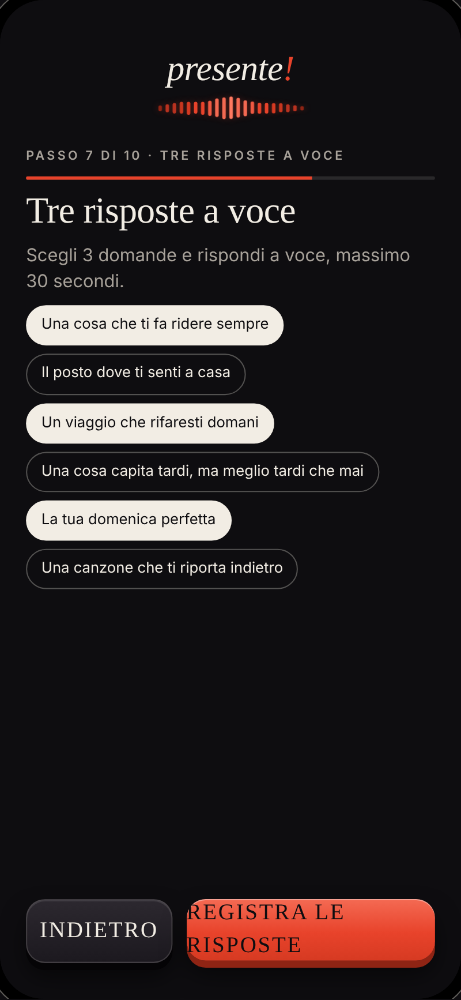

Le domande come pillole, le tre scelte evidenziate.

- Logo centrato con l'onda
- Pulsanti allineati e in 3D
### 10 · Passo 8 · Questionario

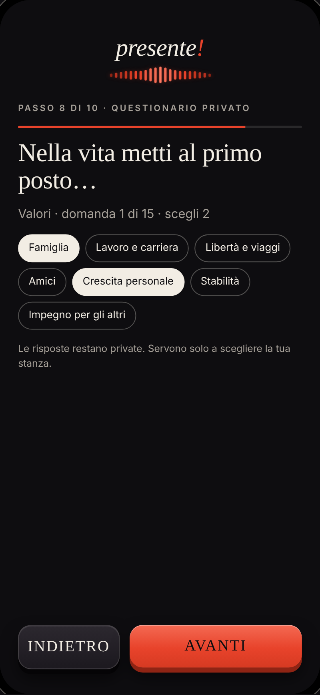

Una domanda per schermata, pulsanti allineati.

- Logo centrato con l'onda
- Pulsanti allineati e in 3D
### 11 · Passo 8 · Una domanda

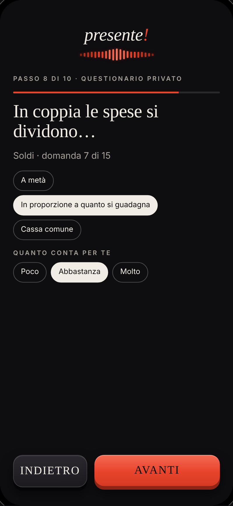

Domanda concreta e quanto conta per te, pulsanti allineati.

- Logo centrato con l'onda
- Pulsanti allineati e in 3D
### 12 · Passo 9 · Le foto

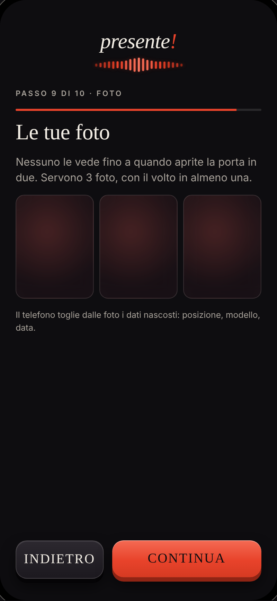

Le tre foto sfocate come le vedranno gli altri prima della porta.

- Logo centrato con l'onda
- Le foto si vedono sfocate: si capisce subito che restano nascoste
- Pulsanti allineati e in 3D
### 13 · I tuoi Coin · nuova

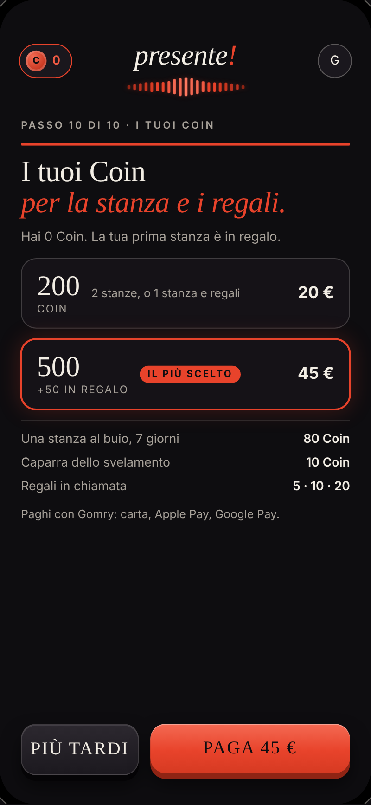

Nuova schermata, subito dopo l'iscrizione: quanti Coin hai, i due pacchetti e quanto costa ogni cosa. La prima stanza resta in regalo.

- Schermata nuova dopo la registrazione
- Due pacchetti: 200 Coin a 20 € e 500 Coin a 45 € (+50 in regalo)
- Cosa costa: stanza 80, caparra 10, regali da 5 a 20
- Pagamento con Gomry
### 14 · Pagamento con Gomry · nuova

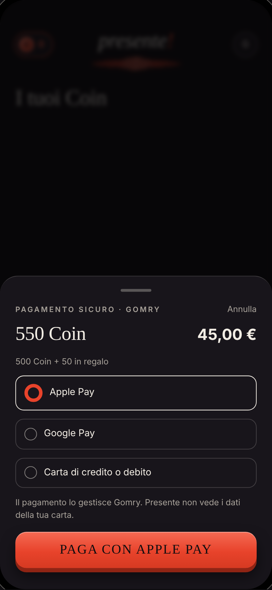

Nuova schermata: il foglio di pagamento di Gomry sale dal basso. Presente non vede i dati della carta.

- Schermata nuova
- Pagamento con Gomry: Apple Pay, Google Pay o carta
- Un pulsante solo per pagare
### 15 · Coin caricati · nuova

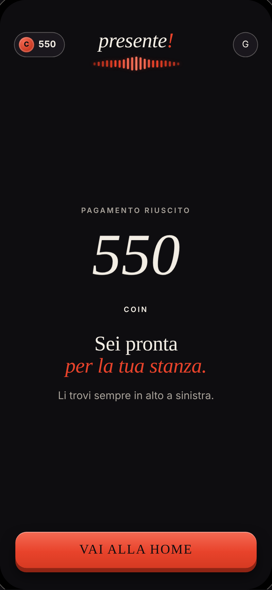

Nuova schermata: conferma del pagamento, con il saldo che sale. Il saldo resta sempre visibile in alto a sinistra.

- Schermata nuova
- Il saldo in Coin è sempre in alto a sinistra, accanto al logo
### 16 · La home

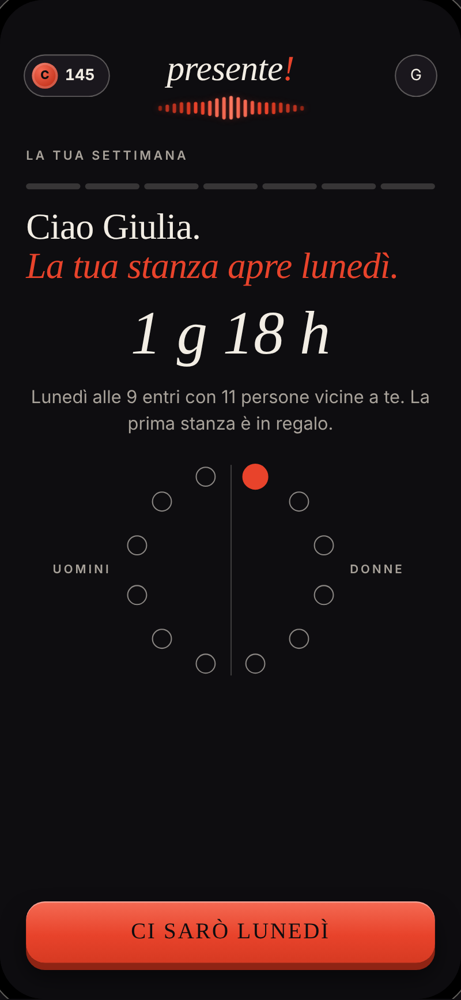

Prima della stanza: il conto alla rovescia al lunedì. L'elenco delle persone sta solo nella stanza, «Elimina account» solo nel profilo.

- Logo centrato con l'onda e il profilo in alto a destra
- Niente elenco persone né «Elimina account» nella home
- Una sola cosa da fare: il conto alla rovescia alla stanza
### 17 · Scegli la stanza · nuova

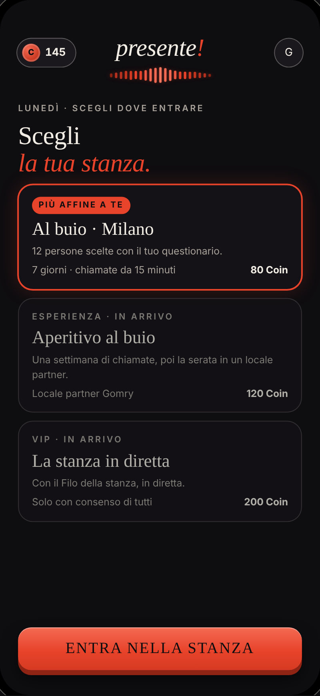

Nuova schermata, per quando ci saranno più stanze: in cima la stanza con le persone più affini, sotto le stanze con un'esperienza. Le esperienze sono in arrivo.

- Schermata nuova
- Prima proposta: la stanza con le persone più affini
- Sotto: stanze Esperienza e VIP (in arrivo)
- Il costo in Coin su ogni stanza
### 18 · Il Filo apre la stanza · nuova

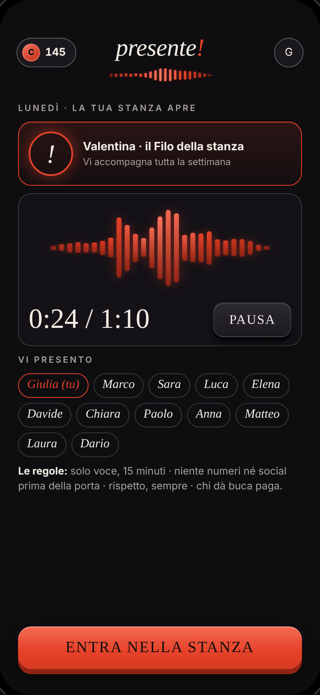

Nuova schermata, il lunedì all'apertura: il vocale di benvenuto del Filo della stanza (la persona vera della città che la accompagna). Dice i nomi di tutti e ricorda le regole. Si può riascoltare dalla stanza per tutta la settimana.

- Scheda del Filo con il simbolo «!» nel cerchio rosso (mai la sua foto qui)
- Vocale con l'onda grande, si riascolta quando vuoi
- Solo i nomi di battesimo delle 12 persone, tu evidenziata in rosso
- Le regole in una riga, poi si entra nella stanza
### 19 · La stanza

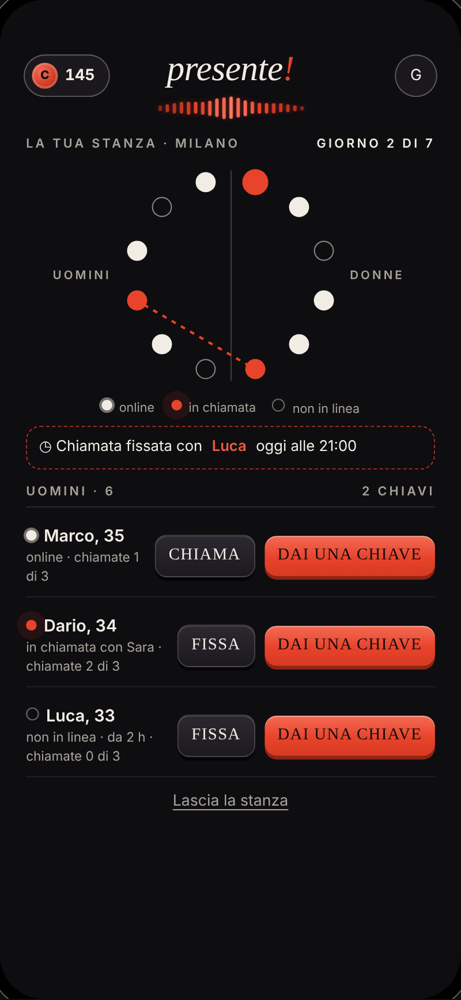

Il cerchio si muove: vedi chi è online, chi è in chiamata e con chi (la linea rossa tra i due). Se una persona è occupata o non c'è, al posto di «Chiama» trovi «Fissa» per darvi un appuntamento.

- Stato di ogni persona: online (punto chiaro che pulsa), in chiamata (rosso), non in linea
- Nel cerchio, una linea rossa unisce chi è in chiamata
- «Fissa» al posto di «Chiama» quando la persona è occupata o non in linea
- Gli appuntamenti fissati compaiono in cima alla stanza
### 20 · Fissa una chiamata · nuova

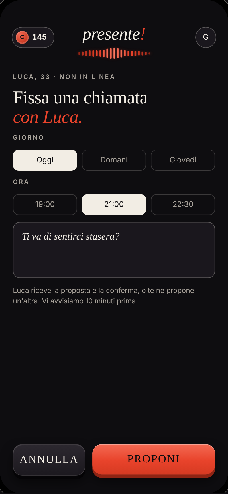

Nuova schermata: quando una persona è occupata o non in linea, le proponi un giorno e un'ora. Lei conferma e vi avvisiamo 10 minuti prima.

- Schermata nuova
- Giorno e ora a scelta, entro la settimana della stanza
- L'altra persona conferma o propone un altro orario
- Promemoria 10 minuti prima a tutti e due
### 21 · Coin quasi finiti · nuova

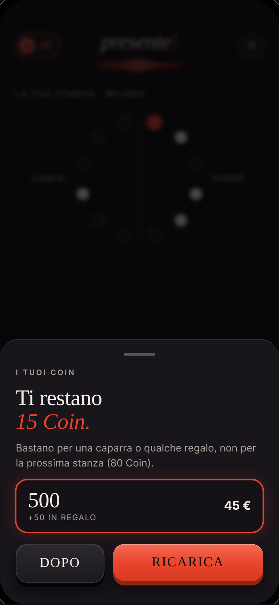

Nuova schermata: quando i Coin non bastano per la prossima stanza, il saldo in alto diventa rosso e arriva un invito a ricaricare.

- Schermata nuova
- Saldo in rosso quando i Coin stanno finendo
- Spiega cosa si può ancora fare e cosa no
- «Dopo» e «Ricarica» sulla stessa riga
### 22 · Lascia la stanza · nuova

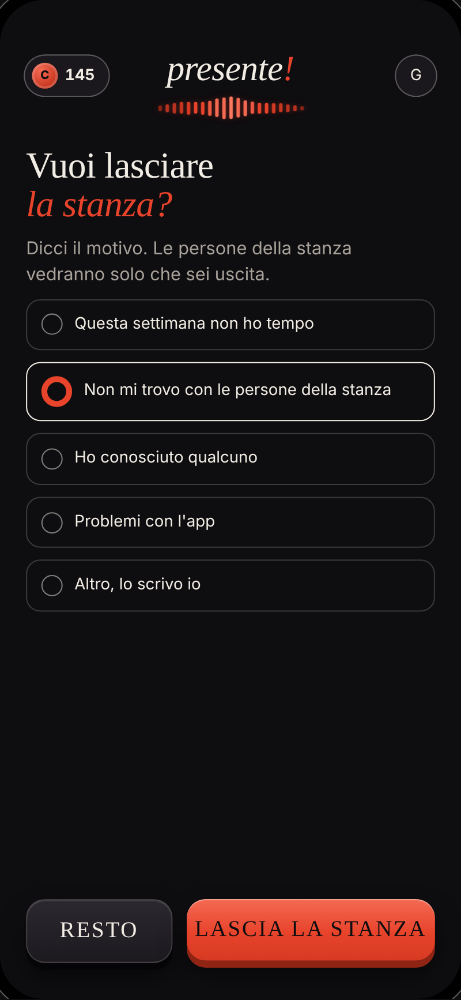

Nuova schermata: chi lascia la stanza sceglie un motivo. Gli altri vedono solo che è uscito.

- Schermata nuova
- Motivo obbligatorio, scelto da un elenco o scritto
- Il motivo non lo vede nessuno della stanza
### 23 · Il profilo · nuova

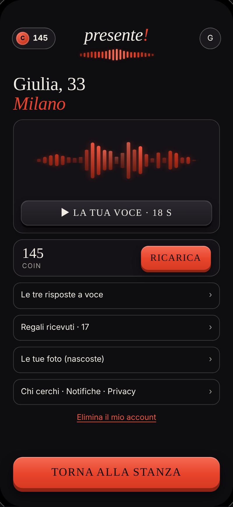

Nuova schermata: il profilo si apre dal cerchio in alto a destra. Qui modifichi voce, risposte, foto e preferenze; in fondo c'è «Elimina il mio account».

- Schermata nuova, dal cerchio in alto a destra
- «Modifica» e «Elimina account» tolti dalla home e dalla stanza
### 24 · La chiamata · Squilla

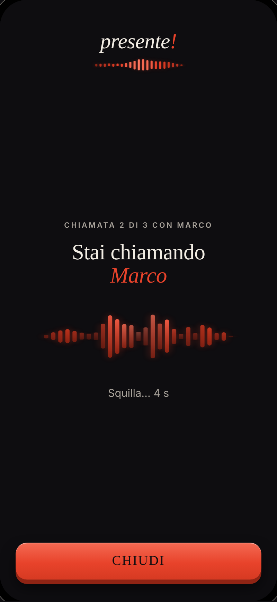

Mentre la linea si collega, l'onda pulsa al centro. Sotto, quante chiamate hai fatto con questa persona.

- Onda nei toni del rosso, più morbida, che pulsa mentre prende la linea
- Logo centrato con l'onda
- «CHIUDI» in 3D e in maiuscolo
### 25 · La chiamata · 15 minuti

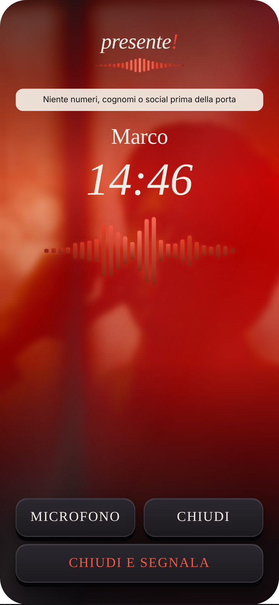

Durante la chiamata: dietro, una sagoma che si muove oltre un vetro rosso; sopra, l'onda viva della voce e il timer.

- Sfondo più vivo: la sagoma ondeggia e le luci si muovono dietro il vetro
- Sagoma maschile perché parla una donna (Giulia); femminile se parla un uomo
- Sfondo: sagoma in movimento dietro un vetro rosso (nessun volto)
- Onda viva sopra la sagoma
- «Microfono» e «Chiudi» sulla stessa riga, in 3D; «Chiudi e segnala» sotto
### 26 · La chiamata · I regali · nuova

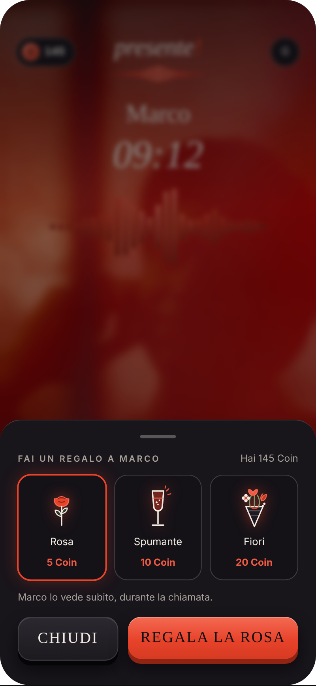

Nuova schermata: durante la chiamata il tasto «Regalo» apre i tre regali. Si paga con i Coin, il saldo è in alto.

- Disegno nuovo per i fiori: un mazzo misto, non di rose
- Rosa 5 Coin, spumante 10, fiori 20
- Il saldo si aggiorna subito
### 27 · La chiamata · Regalo ricevuto · nuova

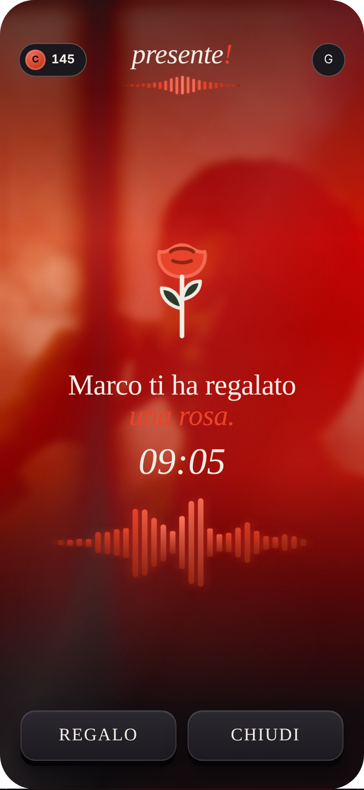

Nuova schermata: chi riceve il regalo lo vede comparire sopra la chiamata, con un'animazione leggera.

- Schermata nuova
- Il regalo compare sopra l'onda, poi sparisce da solo
- I regali ricevuti restano nel profilo
### 28 · I tuoi regali · nuova

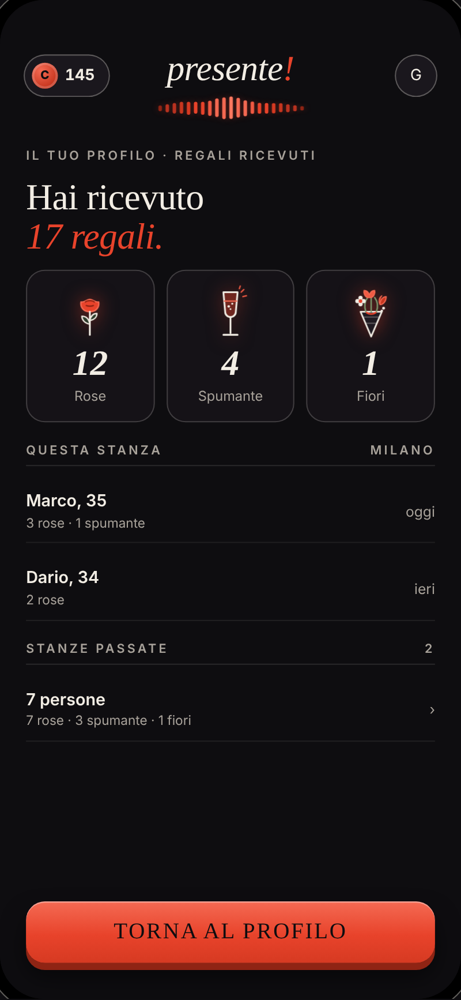

Nuova schermata, dal profilo: il numero di regali ricevuti per tipo e da chi, stanza per stanza.

- Schermata nuova, dal profilo
- Totale per tipo: rose, spumante, fiori
- Elenco per persona e per stanza
### 29 · La chiamata · Le carte

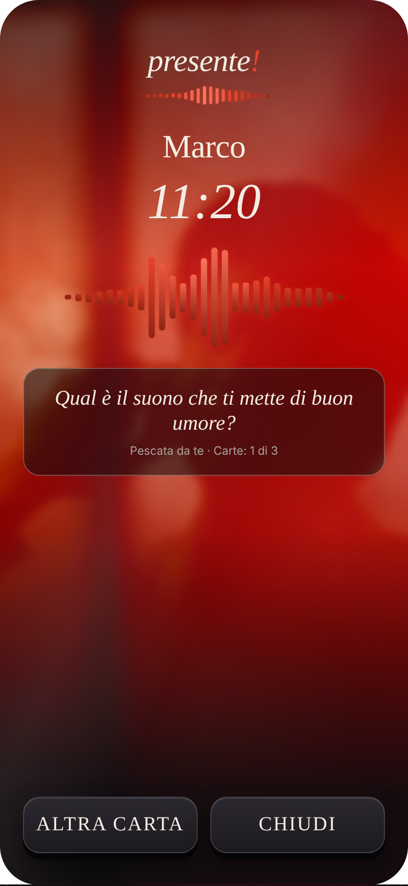

La carta rompighiaccio appare sopra lo stesso sfondo della chiamata.

- Stesso sfondo della chiamata: sagoma dietro il vetro rosso
- Onda viva sopra la sagoma
- Pulsanti allineati e in 3D
### 30 · La chiamata · Ultimo minuto

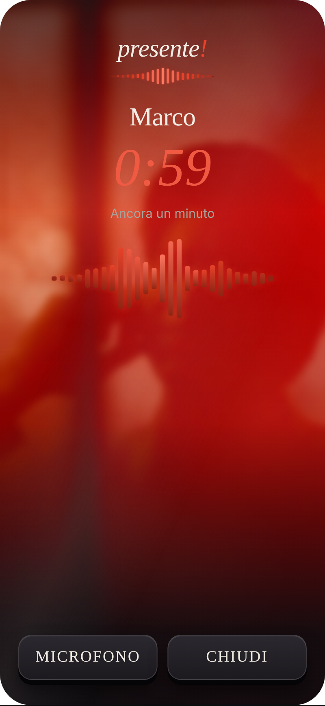

L'ultimo minuto: il timer diventa rosso, l'onda continua sopra la sagoma.

- Stesso sfondo della chiamata
- Timer rosso nell'ultimo minuto
- Pulsanti allineati e in 3D
### 31 · Dopo la chiamata

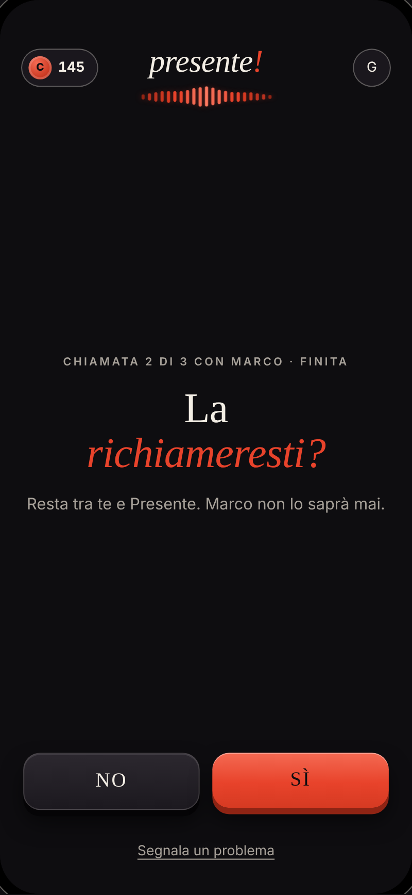

Sì o no in privato, sulla stessa riga e in 3D.

- Logo centrato con l'onda
- «Sì» e «No» allineati, in 3D
### 32 · Il diario

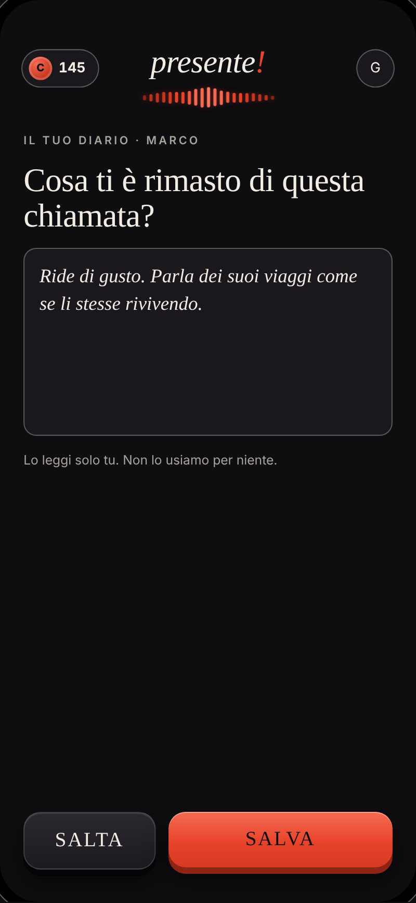

Il diario privato, con «Salta» e «Salva» sulla stessa riga.

- Logo centrato con l'onda
- «Salta» e «Salva» allineati, in 3D
### 33 · Le chiavi

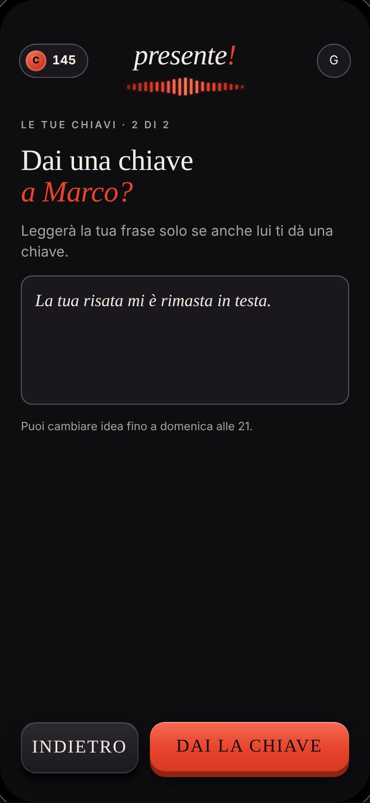

La chiave si dà da una schermata sua, con la frase e i pulsanti allineati.

- Schermata dedicata invece del riquadro dentro la stanza
- Pulsanti allineati e in 3D
### 34 · Chiave data

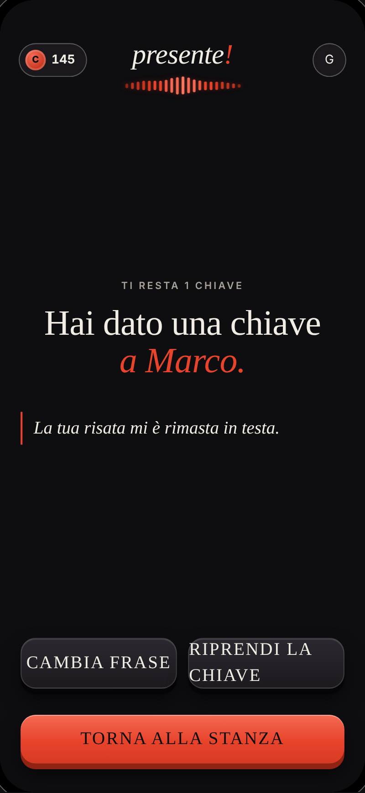

Conferma breve; si torna alla stanza.

- Logo centrato con l'onda
- «Cambia frase» e «Riprendi la chiave» allineati, in 3D
### 35 · Domenica sera

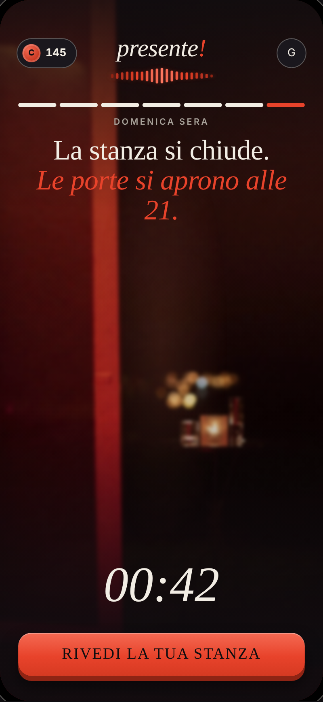

Domenica sera: una porta scorrevole socchiusa con la luce calda di un tavolo che aspetta. Sopra, il conto alla rovescia alle 21.

- Immagine nuova, calda e accogliente al posto di quella scura
- La luce oltre la porta respira piano
- Pulsanti con il nuovo carattere
### 36 · Il Filo · le porte aperte · nuova

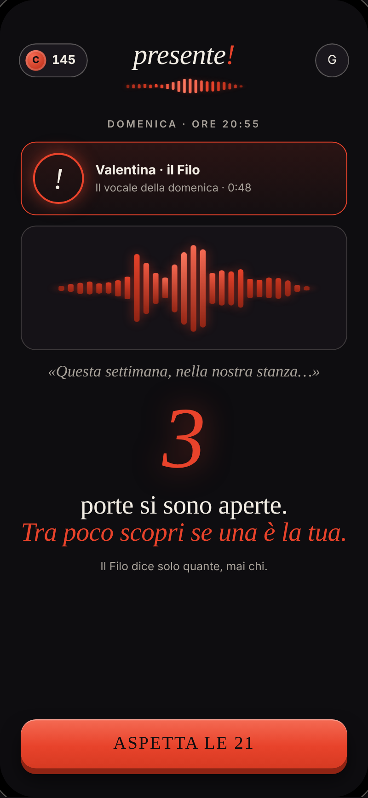

Nuova schermata, domenica poco prima delle 21: il vocale del Filo annuncia quante porte si sono aperte nella stanza. Solo il numero, mai chi.

- Vocale della domenica con l'onda
- Il numero grande in rosso
- «Solo quante, mai chi»: se una è la tua lo scopri alle 21
### 37 · La porta

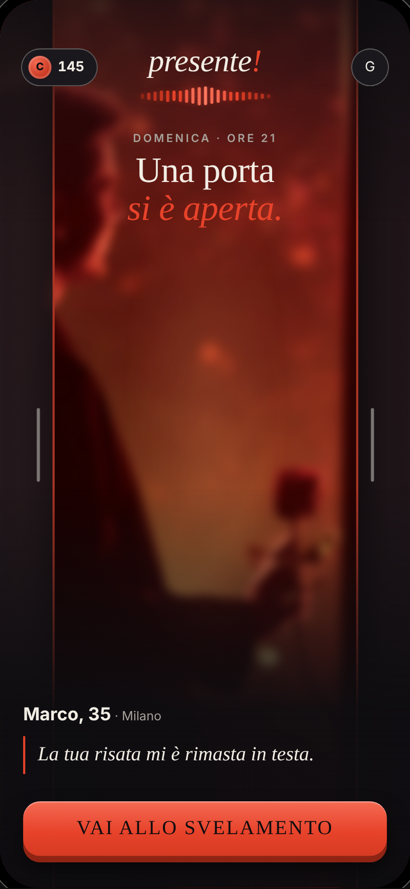

Le ante scorrono una volta sola, morbide, fino in fondo. Dietro, una luce calda e la sagoma di chi ti ha scelto, con una rosa in mano. Maschile se tu sei donna, femminile se sei uomo.

- Immagine nuova, calda e romantica al posto di quella inquietante
- Apertura morbida e continua, senza scatti né blocchi
- Dopo l'apertura, la luce respira piano
### 38 · La porta · se sei un uomo · nuova

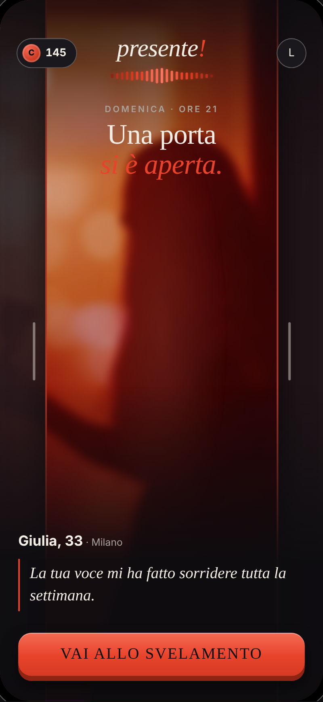

La stessa porta vista da un uomo (qui Luca): dietro le ante, la sagoma di lei con una rosa in mano, nella stessa luce calda. Mai un volto a fuoco.

- Versione per gli utenti uomini
- Sagoma femminile con la rosa, stessa luce e stessa apertura morbida
- Il resto della schermata è identico
### 39 · Lo svelamento

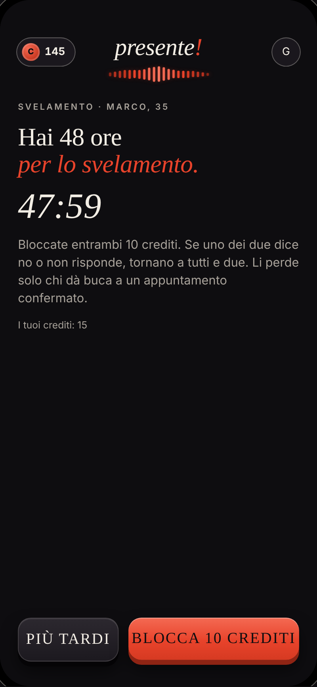

La caparra spiegata in tre righe, pulsanti allineati.

- Logo centrato con l'onda
- Testo più breve sulla caparra
- Pulsanti allineati e in 3D
### 40 · Lo svelamento · Come

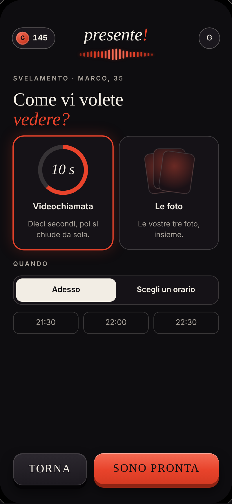

Ridisegnata: due grandi scelte con un'immagine ciascuna (il cerchio dei 10 secondi, le foto sfocate) e l'orario in un selettore unico.

- Due schede grandi al posto di quattro pulsanti
- Il cerchio dei 10 secondi per il video, le foto sfocate per le foto
- «Adesso» o un orario, in un selettore unico
### 41 · La serata della stanza · nuova

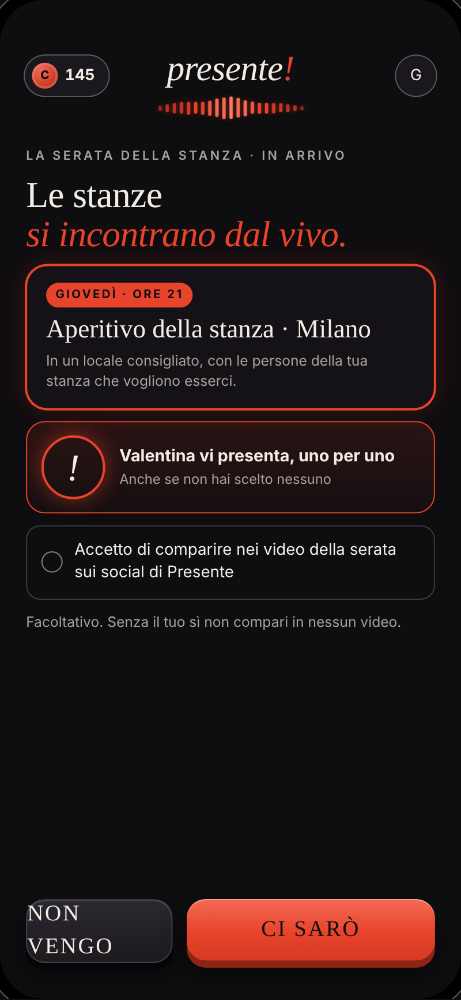

Nuova schermata (in arrivo): l'invito alla serata in cui le persone della stanza si incontrano dal vivo, anche senza porte aperte. Il Filo presenta tutti, uno per uno, e racconta la serata sui social solo con chi ha detto sì.

- Invito alla serata con giorno, ora e locale consigliato
- Il Filo presenta tutti, anche chi non ha scelto nessuno
- Consenso separato e facoltativo per comparire nei video (spento di base)
- «Non vengo» e «Ci sarò» allineati, in 3D
